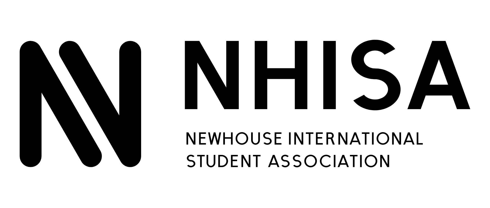

# NHISA logo

**The idea:** two strokes make one N and run side by side through the middle: the time we share.
One stroke is someone who was here first, the other someone who has just arrived. Neither makes an N alone. Turn the mark half a circle and it is the same shape: each class is handed what the last one held.

## Versions

| Use | File | Notes |
|---|---|---|
| Site header, slides, documents | `logo/nhisa-horizontal.svg` | The primary logo |
| Posters, letterheads, first contact | `logo/nhisa-full-name.svg` | With the full name; only where it can be at least 260 px wide |
| Square spaces, merch, signs | `logo/nhisa-stacked.svg` | |
| Wordmark on its own | `logo/nhisa-wordmark.svg` | When the symbol is already nearby |
| Symbol on its own | `logo/nhisa-symbol.svg` | 32 px and up |
| Symbol at 16–31 px | `logo/nhisa-symbol-small.svg` | Heavier strokes and a wider gap, so the two diagonals stay apart |
| Instagram / LinkedIn avatar | `logo/nhisa-avatar.svg`, `png/nhisa-avatar.png` | White on black, kept inside the circle crop |
| Browser tab, app icon | `web/` | `favicon.ico`, `favicon.svg`, PNG icons, `site.webmanifest`, `head-snippet.html` |

Each master is black, for light grounds, with a white `-reversed` file for dark grounds. Ready-made PNGs are in
`png/`. Use SVG wherever you can.

## Clear space and size

Keep a clear space of **two stroke widths** of the N on every side, at whatever size the logo is used.
The files carry only a small margin, so leave the rest around them.

| Version | Smallest on screen | Smallest in print |
|---|---|---|
| Horizontal | 120 px wide | 30 mm wide |
| Full name | 260 px wide | 60 mm wide |
| Stacked | 80 px wide | 20 mm wide |
| Symbol | 24 px (16 px with the small cut) | 8 mm (5 mm with the small cut) |

## Colour

The logo is **black and white only**: black (`#000000`) on light grounds, white (`#FFFFFF`) on dark ones. The two
strokes are told apart by the gap between them, not by colour. Contrast is 21 : 1 either way.

**Approved pairs:** black on white or any light ground · white on black or any dark ground, including the site's
Night (`#090B14`) and Navy (`#232860`). On photos, use whichever reads on a calm area, or the avatar tile.

## Type

The wordmark and the full name are drawn shapes, not a font, so never retype them. Set text beside the logo in
**General Sans** (the site's typeface, free for commercial use from Fontshare), falling back to `system-ui`.

## Please don't

Stretch, squash, rotate or mirror the logo (mirrored, the N reads as И) · print it in any colour but black or white ·
give the two strokes different colours · close the gap between the diagonals · add shadows, outlines, gradients or glows · rearrange or resize the parts of a lockup · put it on a busy
photo without the avatar tile · use the Syracuse Block S or Syracuse Orange inside the NHISA logo.

## How it is built

On a 256-unit grid: two strokes 36 units wide with round ends, each a stem and a diagonal. The diagonals run 30° off
vertical, 20 units apart, and the N is 208 units tall. The small cut has strokes 40 wide and 24 apart. In the
horizontal logo the N is 128 units tall, centred on the wordmark's 84-unit caps and two stroke widths clear of them.
Reversed files are drawn about 3.5 % thinner, because light shapes on dark grounds look heavier. The letters are
geometric capitals with 22-unit stems, thinner horizontals and a 30° diagonal in the N.

The masters are generated by `source/build_logo.py` (`python source/build_logo.py <out-dir>`), so a change to a
measurement or colour is made there, not by hand in the SVGs. The board in `presentation/nhisa-logo.html` (slides in
`presentation/slides/`) shows the logo in use. An earlier direction, Ring by Ring, is in the git history at
commit `14fca65`.

**Before wider use:** no trademark search has been run. Check SU's rules for registered student organizations
before printing merchandise.
